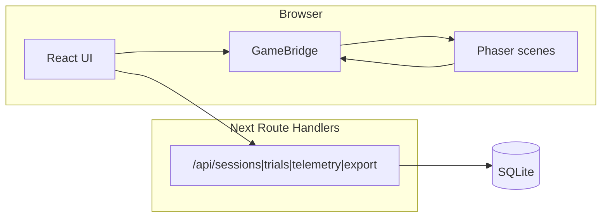

# The Collector

Experimental **2D browser task** for motor-imagery BCI research: guided **offline** calibration (known labels, automatic avatar motion) and **online** continuous feedback (mock streaming now; pluggable adapters for real signals later).

Stack: **Next.js 16 (App Router)**, **React 19**, **TypeScript (strict)**, **Phaser 3**, **Prisma + SQLite**, **Zustand**, **Zod**, **Vitest**. UI uses **CSS Modules** (no Tailwind).

## Node version

This repo targets **Node 24** (see [`.nvmrc`](.nvmrc)).

```bash
nvm use 24   # or: nvm install 24 && nvm use 24
```

## Install

```bash
nvm use 24
npm install
```

Copy environment for the database URL:

```bash
cp .env.example .env
```

## Prisma (SQLite)

Generate the client and apply migrations:

```bash
nvm use 24
npm run db:generate
npm run db:migrate
```

Open Prisma Studio:

```bash
npm run db:studio
```

The default `DATABASE_URL` in `.env.example` points at `file:./prisma/dev.db`.

### WAL mode (optional)

For local experimentation you can enable SQLite WAL (often better concurrency):

```bash
sqlite3 prisma/dev.db "PRAGMA journal_mode=WAL;"
```

There is also an optional helper `enableSqliteWalMode()` in [`src/lib/db/prisma.ts`](src/lib/db/prisma.ts) you can call from a one-off script if you prefer.

## Run the app

```bash
nvm use 24
npm run dev
```

Then open [http://localhost:3000](http://localhost:3000). Use **Game** to run sessions and **Results** to inspect past sessions and export JSON/CSV.

Offline **Start session** asks the pipeline service to record the Cyton LSL inlet. Online **Start session** asks it to start the simulator (or to listen to the Cyton when Online source is `cyton`). Run the service first, from `pipeline/`:

```bash
uv run pipeline serve
```

The recording is written to `pipeline/recordings/<session id>`. Point **Recorded session dir** at that folder and set Dataset to `recorded_session` to replay it online.

## Tests

```bash
nvm use 24
npm run test
```

## Architecture (short)

- **React / Next**: menus, settings, HUD, persistence calls, results — no game loop.
- **Phaser (client-only)**: scenes, physics, trial FSM, telemetry batching — [`PhaserGameContainer`](src/components/PhaserGameContainer.tsx) mounts one `Phaser.Game` and destroys it on unmount.
- **Bridge**: typed commands/events between UI and game — [`GameBridge`](src/game/bridge/game-bridge.ts), [`src/types/bridge.ts`](src/types/bridge.ts).
- **API**: Route Handlers under [`app/api`](app/api) + Zod validation + repositories in [`src/lib/repositories`](src/lib/repositories).



## Online BCI input (external apps)

`OnlineScene` is **adapter-agnostic**: it subscribes to a [`ControlAdapter`](src/game/adapters/control-adapter.ts) from [`createOnlineInputAdapter`](src/game/adapters/online-adapter-factory.ts). **Dead zone, gain, EMA smoothing, and clamp** stay in [`processControlSample`](src/game/systems/control-pipeline.ts); adapters only deliver `BCIControlSample` values.

Choose the source under **Settings → Online BCI input** on the Game page. The choice applies when you **Start** a session (new adapter instance per run).

### Sample shape (`BCIControlSample`)

External tools must send objects equivalent to:

```json
{
  "left": 0.35,
  "right": 0.65,
  "timestamp": 12345.6
}
```

- `left`, `right`: **finite** numbers in **`[0, 1]`** (e.g. class probabilities for two classes).
- `timestamp`: a **finite** number (e.g. `performance.now()` or `Date.now()`).

Malformed payloads are **dropped**; the HUD shows **`BCI_INPUT_STATUS`** (and optional console output when **BCI debug logging** is on). See [`src/lib/bci/validate-sample.ts`](src/lib/bci/validate-sample.ts).

### A) `window` — `CustomEvent` in the app tab

- **Name:** `collector:bci-sample`
- **Payload:** `event.detail` = the object above

Example from the browser console (same page as the game, online mode, adapter = window):

```js
window.dispatchEvent(
  new CustomEvent("collector:bci-sample", {
    detail: { left: 0.1, right: 0.9, timestamp: performance.now() },
  })
);
```

### B) `websocket` — one JSON object per text message

Set **WebSocket URL** in Settings, start the session, then point your BCI bridge at the same URL. Each message should be JSON with `left`, `right`, `timestamp` as above (or a one-element array of that object). On disconnect, the client uses an **exponential backoff** reconnect scaffold (configurable max attempts and delays in Settings) until it gives up with status `exhausted`.

The repo does not ship a WebSocket server; run your own relay next to the browser.

### C) `mock` (default)

[`MockControlAdapter`](src/game/adapters/mock-control-adapter.ts) – built-in test stream, unchanged.

### UI

- **HUD** (online): latest BCI input status line.
- Debug output uses `Settings → Online BCI input → BCI debug logging`.

See [`src/game/adapters/window-event-control-adapter.ts`](src/game/adapters/window-event-control-adapter.ts) and [`src/game/adapters/websocket-control-adapter.ts`](src/game/adapters/websocket-control-adapter.ts).

## Why this stack

- **Next.js**: one codebase for UI + HTTP API + deployment.
- **Phaser 3**: stable 2D loop, Arcade physics, decoupled from React rendering.
- **SQLite + Prisma**: zero-config local persistence for lab machines; easy export.

## Troubleshooting

- **API or UI errors after clone**: run `npm run db:migrate` so `prisma/dev.db` exists; confirm `.env` matches `.env.example`.
- **Telemetry not saving after Stop**: fixed in current code by flushing batches before `SESSION_STOPPED`, and the client falls back to `samples[0].sessionId` if the ref was cleared.
- **Phaser canvas blank**: ensure `/game` loaded fully (dynamic import); check the browser console for WebGL/canvas errors.

## Optional next steps

- Wire **LSL** or a lab relay into `WebSocketControlAdapter` or a dedicated **Server-Sent Events** endpoint.
- Participant IDs and **audit** rows via `SessionEvent`.
- Normative scaling of classifier output per session block.
